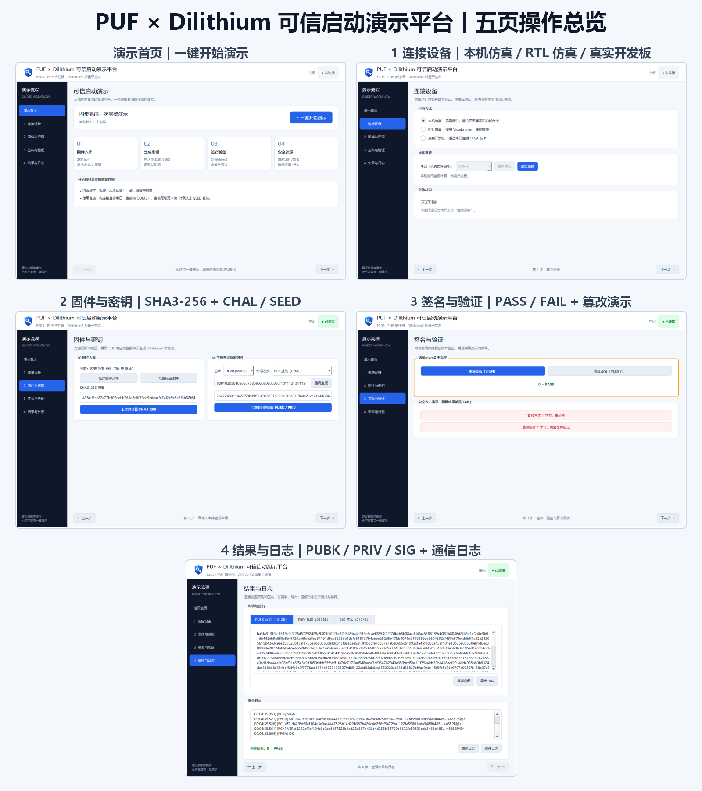

# 可信启动演示平台 · PC 前端 GUI

PyQt5 上位机演示“2KB 固件 → SHA3-256 度量 → 256 bit 密钥种子 → Dilithium2 密钥生成 → 签名 → 验签 → 篡改拒绝”的完整链路，支持 **全链路仿真（RTL）** 与 **硬件开发板** 两种运行方式。

> **技术声明**：RTL 仿真中的 PUF 是 testbench 内行为模型 `R = SHAKE-256(C ‖ DEVICE_CONST)`，不是物理 PUF。硬件开发板已接普安信 HD13HS10K 真 PUF 芯片（I2C，2026-10-21 全链路实测 PASS，见 `D:\FPGA\sim_logs\BOARD_PUF_NOTES.md`）。



## 30 秒跑起来

```bat
cd /d D:\FPGA\puf_pqc_demo_gui
python -m pip install -r requirements.txt
python main.py
```

默认运行方式为「全链路仿真（RTL）」。真板演示不再需要先跑 `一键启动_真板演示.bat`——其全部操作（清理残留进程、启动 openocd、下载固件+串口自检）已内建到「1 连接设备」页的「一键拉板」按钮。

## 界面导览（六页）

| 左侧页面 | 主要操作 |
|---|---|
| 演示首页 | “▶ 一键开始演示”；实时状态徽标（固件/密钥/上次验签）；信任链流水线 |
| 1 连接设备 | 选择 全链路仿真（RTL）/ 硬件开发板；“刷新串口”“连接设备”；真板“一键拉板”操作区 |
| 2 固件下载 | 内置标准固件 / 外部文件（错误固件演示）；“上传并计算 SHA3-256”；摘要 64 位完整显示 + 与标准固件金样比对 |
| 3 密钥生成 | CHAL / SEED 选择；256bit 激励随机生成或手动输入（实时 bit 计数）；PUBK / PRIV 完整显示与导出 |
| 4 签名与验证 | SIGN / VERIFY；验签大图卡（PASS 绿 / FAIL 红并写明 FAIL 归属：正常异常 or 篡改演示如期）；完整 SIG 显示与导出；两种篡改 FAIL 演示 |
| 用户操作说明 | 操作指引、参数设置（波特率/超时/篡改随机/深色模式）、演示报告导出、技术背景 |

每个步骤页底部有「设备实况」窗：RTL 模式实时滚动 xsim console 日志，真板模式回显串口收发。页脚有分步进度条（RTL 长操作按历史实测耗时估算）和「■ 终止当前操作」按钮（立即杀 xsim 进程树并清理信箱残留，不产生卡顿）。

## 两种运行方式

| | 全链路仿真（RTL，默认） | 硬件开发板 |
|---|---|---|
| 计算位置 | 常驻 Vivado xsim 中的 E203 + Dilithium RTL | FPGA 板端 E203 固件与硬件核 |
| PUF / 种子 | testbench 内 PUF 行为模型，固定 DEV0 | 真 PUF 芯片（HD13HS10K，I2C）或 SEED 直注 |
| 速度 | 分钟级，完整流程约 41 分钟 | 取决于板端计算和串口传输 |
| 用途 | RTL 与协议对拍、硬件行为验证、取数 | 真板链路演示与验收 |
| 前提 | Vivado 2019.2 + RTL 工程 | FPGA 板、JTAG、USB 串口；先「一键拉板」 |

### 硬件开发板使用要点

- 在「1 连接设备」选「硬件开发板」→ 选好 COM 口 → 点「一键拉板」（等效原 `一键启动_真板演示.bat`：清理残留 openocd/gdb → 启动 openocd → gdb 下载 `test_board_puf.elf` → 串口 HELP×2 + CHAL 真 PUF 自检），输出实时显示在页底「设备实况」。
- 自检通过后点「连接设备」。
- 更换 PUF 板子：直接把连线换到另一块板即可，窗口无需改动。
- **FLASH 持久化成功**：断电再上电仍有 FPGA 设计；**固件不随上电自动运行**，每次上电需重新拉板。

完整的真板准备、命令和故障排查见 **[docs/BOARD_OPERATION_GUIDE.md](docs/BOARD_OPERATION_GUIDE.md)**。

## 全链路仿真（RTL）方式

在「1 连接设备」选择「全链路仿真（RTL）」，点击「连接设备」，然后回首页一键演示或逐页操作。PC 经 `xsim_link.py` 与 `tb_top_link.v` 的文件信箱桥驱动常驻 xsim；签名和验签在 Dilithium RTL 核完成，PUF 仍是 testbench 内行为模型。

- 连接时强制核验 xsim 进程真实存在（否则连接直接失败并报中文原因）——界面结果必然来自真实 RTL。
- 首次连接可能包含 RTL 编译；芯片下拉固定 DEV0。
- 慢是正常现象：FW 入库约 19 分钟、SIGN 约 5 分钟、VER 约 10 分钟，完整一键演示约 41 分钟。
- 中途可随时点页脚「■ 终止当前操作」；关窗自动快速收尸，不卡不残留。
- 更多说明见 [RTL_MODE_GUIDE.md](docs/RTL_MODE_GUIDE.md)。

## 对拍金样值

使用内置 2KB `00..FF` 循环固件、DEV0、默认挑战 `000102…1f` 和 CHAL 时：

| 项目 | 预期值 |
|---|---|
| 固件 SHA3-256 | `498cd3cc87a77b907debb761a2e6f59ed9edeaefc74f2c9c5c5f3b62f64c4aa1` |
| 篡改固件 1 字节后的 SHA3-256 | `40e61a44dc7f5a785b71eb98fe716760f2b0e73e99c824489594e26ba4df02e5` |
| DEV0 行为模型响应 R | `7a472b8311da5759b39f9618c8731a252a310d318f6dc71ca71c448f4cd31b75` |
| DEV1 行为模型响应 R | `1cc50e310670924813f112c4bcced97851b9bf346717ff74581fb5bf4c14b98b` |
| DEV0 PUBK 前缀 | `ba5fa313ffba9519…` |
| DEV1 PUBK 前缀 | `2fed1907ec4f0c8c…` |

RTL 模式 DEV0 的 PUBK/PRIV 必然与 `expected_hw_values.json` 逐字节一致（同一 RTL 同一金样）。官方 KAT 和对拍细节见 `test_kat_output.txt`。

## 项目结构

```text
puf_pqc_demo_gui\
├── main.py                     六页 PyQt5 GUI
├── backend.py                  XsimBackend / SerialBackend / SimBackend（自测用）
├── board_demo_run.py           COM3 真板全链路脚本
├── xsim_link.py                RTL 文件信箱桥客户端（含进程核验与即时中止）
├── test_rtl_abort.py           RTL 中途终止实测
├── demo_screenshot.png         一键演示完成态截图
├── assets\logo.png             应用 Logo
├── vendor\dilithium_py\        内嵌 Dilithium2 实现
├── requirements.txt            PyQt5 + pyserial
└── docs\
    ├── USER_MANUAL.md          GUI 操作手册
    ├── BOARD_OPERATION_GUIDE.md 真板准备、openocd/gdb、GUI 与排障
    ├── DEMO_GUIDE.md           现场演示脚本与问答
    ├── RTL_MODE_GUIDE.md       RTL 仿真专项说明
    ├── DEVELOPER.md            架构与维护说明
    ├── DOC_INDEX.md            文档和截图导航
    ├── make_screenshots.py     真实 Windows 桌面截图工具
    ├── make_overview.py        总览拼图工具
    └── screenshots\            文档截图
```

## 文档导航

| 需求 | 文档 |
|---|---|
| 第一次使用或逐项了解控件 | [USER_MANUAL.md](docs/USER_MANUAL.md) |
| 真实开发板准备、下载固件、排障 | [BOARD_OPERATION_GUIDE.md](docs/BOARD_OPERATION_GUIDE.md) |
| 10 分钟现场讲解 | [DEMO_GUIDE.md](docs/DEMO_GUIDE.md) |
| RTL 仿真专项操作 | [RTL_MODE_GUIDE.md](docs/RTL_MODE_GUIDE.md) |
| 架构、协议与维护 | [DEVELOPER.md](docs/DEVELOPER.md) |
| 全部文档与截图索引 | [DOC_INDEX.md](docs/DOC_INDEX.md) |

## 声明与边界

- RTL 模式的 PUF 为行为模型，只有硬件开发板模式接的是物理 PUF（HD13HS10K）。
- 帧层协议与 `D:\FPGA\sim_logs\UART_PROTOCOL.md` 对齐，命令语义与 `D:\FPGA\Dilithium-master\main_demo.c` 对齐。
- 签名为确定性签名，与当前硬件核及其验证向量一致。
- 私钥展示和导出只用于演示验收，不代表产品级密钥管理设计。
