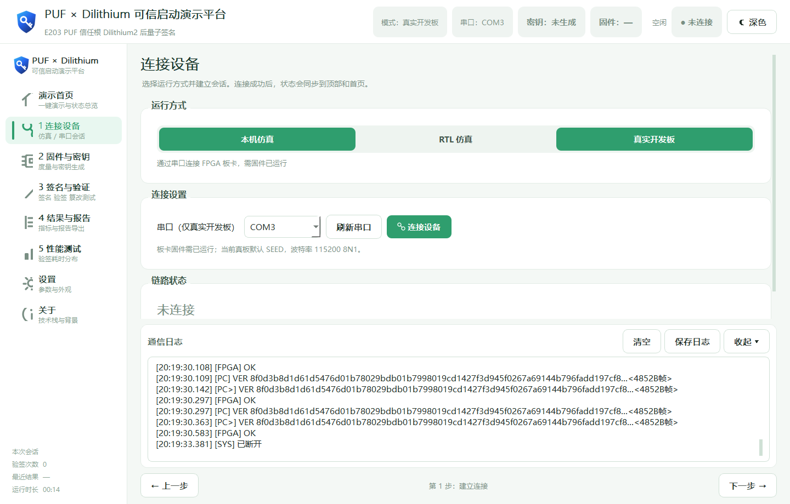

# 真实开发板操作指南

本指南适用于当前 Nuclei/E203 + Dilithium 演示板的实际上板流程，覆盖板卡准备、openocd、gdb 固件下载、新五页 GUI 和常见故障。

> **当前真板声明**：真实串口全链路已经实测通过，`board_demo_run.py` 已真板 PASS。当前板上**没有接入物理 PUF**，演示默认使用 **SEED 直注**提供 256 bit 密钥种子；这不是物理 PUF 挑战—响应。后续接入物理 PUF 并完成链路确认后，才切换为 CHAL。
>
> **断电后的真实状态**：FPGA 设计的 FLASH 持久化已成功，上电后仍有 FPGA 设计；但 `test_board_uart0.elf` 处理器固件目前**不会随上电自动运行**，每次断电重新上电后仍须执行 openocd + gdb 下载并恢复固件。

## 1. 准备清单

### 硬件与连接

- 开发板已可靠供电，JTAG 下载器和 USB 串口均已连接电脑。
- Windows 设备管理器能识别串口；当前使用 **COM3**，参数为 **115200 8N1**（8 数据位、无校验、1 停止位）。
- 若重新插拔或换 USB 口，COM 号可能变化，应以设备管理器和 GUI 的串口列表为准。

### 软件与路径

- Python 依赖已安装：在 `D:\FPGA\puf_pqc_demo_gui` 执行过 `python -m pip install -r requirements.txt`。
- openocd：`D:\FPGA\NucleiStudio\NucleiStudio\toolchain\openocd\bin`。
- 固件：`D:\FPGA\Dilithium-master\test_board_uart0.elf`。
- gdb：`riscv-nuclei-elf-gdb.exe` 可在终端直接调用。
- GUI：`D:\FPGA\puf_pqc_demo_gui\main.py`。

开始前关闭串口助手、旧的 GUI 和 `board_demo_run.py`，确保 COM3 只由一个程序使用。

## 2. 每次上电后的推荐顺序

需要两个持续分开的终端：终端 A 运行 openocd 并保持开启，终端 B 运行 gdb。固件恢复运行后再启动 GUI 或命令行演示。

### 2.1 终端 A：启动 openocd

在 **Git Bash** 中执行：

```bash
cd /d/FPGA/NucleiStudio/NucleiStudio/toolchain/openocd/bin
./openocd.exe -f ../scripts/board/nuclei-demosoc-v2.cfg
```

确认 openocd 能识别 JTAG 链并监听 gdb 端口 **3333**。演示期间不要关闭此终端；它需要继续为调试链提供服务。

### 2.2 终端 B：下载并运行固件

另开一个终端，进入固件目录并启动 gdb：

```bash
cd /d/FPGA/Dilithium-master
riscv-nuclei-elf-gdb.exe test_board_uart0.elf
```

在 `(gdb)` 提示符下**按顺序**执行：

```gdb
target remote localhost:3333
monitor reset halt
load
set $pc=0x80000000
monitor resume
disconnect
quit
```

关键点：`load` 只负责把固件下载到目标；还必须设置入口地址并执行 `monitor resume`，处理器才会真正运行。应先 `monitor resume`，再 `disconnect` 和 `quit`，避免退出 gdb 时把 CPU 留在 halt 状态。

### 2.3 用新 GUI 演示

在第三个终端启动：

```bash
cd /d/FPGA/puf_pqc_demo_gui
python main.py
```

1. 左侧进入 **“1 连接设备”**。
2. 选择 **“真实开发板 通过串口连接 FPGA 板卡”**。
3. 点击 **“刷新串口”**，选择 **COM3**，再点击 **“连接设备”**。
4. 等顶部变为绿色“已连接”，链路状态显示“设备已就绪”。连接会自动执行两次 HELP 同步，结果页日志应能看到 `cmds: CHAL ...`。
5. 进入 **“2 固件与密钥”**，确认“密钥方式”为 **“直接种子（SEED）”**。选择真实开发板时 GUI 会自动切到该方式；当前无物理 PUF，不要改用 CHAL。
6. 回到 **“演示首页”**，点击 **“▶ 一键开始演示”**。也可以手动依次点击“上传并计算 SHA3-256”→“生成密钥并读取 PUBK / PRIV”→“生成签名（SIGN）”→“验证签名（VERIFY）”。
7. 一键演示结束会自动进入 **“4 结果与日志”**。正常验签应显示绿色 **0 = PASS**；可查看 PUBK、PRIV、SIG 和完整通信日志。



### 2.4 可选：命令行真板演示

先关闭 GUI 和其他占用 COM3 的程序，再在 Git Bash 执行：

```bash
python /d/FPGA/puf_pqc_demo_gui/board_demo_run.py
```

脚本使用 COM3，流程为两次 HELP 同步 → FW → **随机 SEED 直注并 keygen** → 读取 PUBK/PRIV → SIGN → VER → 篡改签名后再验签。正常验签应返回 `OK`，最后的篡改验签应返回 `FAIL`。该脚本已在当前真板实测通过。

## 3. CHAL 与 SEED 怎么选

| 密钥方式 | 当前是否使用 | 含义 |
|---|---|---|
| 直接种子（SEED） | **当前真板默认** | 把 GUI 输入框中的 64 hex 直接作为 256 bit 种子，不经过物理 PUF |
| PUF 挑战（CHAL） | 后续接入物理 PUF 后使用 | 发送挑战，由 PUF 响应作为密钥种子；须以实际接线和板端链路正常为前提 |

当前板若误选 CHAL，可能出现 `RES PUF TIMEOUT` 或等待响应超时。切回“直接种子（SEED）”后重新生成密钥即可。SEED 模式结果页显示的是直接注入的种子，不应称为“物理 PUF 响应”。

## 4. 注意事项

- 每次断电重新上电，都要重新确认 openocd/JTAG，并按 §2.2 下载、`resume` 固件；不要因为 FLASH 中已有 FPGA 设计而跳过固件步骤。
- openocd 终端在演示期间保持运行；不要在固件下载未完成时启动第二个 openocd。
- COM3 同时只能由一个程序打开。GUI、命令行脚本、串口助手不可同时占用。
- 一键演示期间顶部显示“忙碌”，请等待它回到“空闲”，不要重复点击按钮或断电。
- “生成签名”要求固件摘要和密钥都已就绪；更换挑战/种子或芯片会清除旧密钥与签名，应重新执行后续步骤。
- 结果页展示和导出私钥仅用于演示验收，不要把演示私钥用于真实产品或公开部署。

## 5. 故障排查

### 5.1 `timeout: cmds` 或 GUI 连接时等待 `cmds:` 超时

表示第二次 HELP 后没有收到板端帮助文本。按顺序检查：

1. COM 号是否确为当前板卡（当前通常 COM3），波特率是否为 115200 8N1。
2. 固件是否在本次上电后完成 `load`、`set $pc=0x80000000` 和 `monitor resume`；仅看到 FLASH 中的 FPGA 设计并不等于固件正在运行。
3. gdb 是否曾在 CPU 仍为 halt 时退出；若是，重新连接 gdb 并恢复运行。
4. 是否有另一个程序占用 COM3；关闭后重新连接。
5. openocd/JTAG 是否仍正常。必要时重新上电，并完整重做 §2 的流程。

### 5.2 COM 被占用 / `Access is denied` / `could not open port`

关闭串口助手、其他 GUI 实例和仍在运行的 `board_demo_run.py`。若曾有程序异常退出，在任务管理器中只结束确认属于本演示的残留 Python 进程，再点击“刷新串口”和“连接设备”。不要在占用者仍运行时反复打开串口。

### 5.3 openocd 报 `JTAG scan chain failed`

- 检查板卡供电、JTAG 接头和 USB 线，确认没有松动。
- 确认使用的是 `nuclei-demosoc-v2.cfg`，且启动目录和相对路径与 §2.1 完全一致。
- 检查是否已有另一个 openocd 或调试工具占用 JTAG。
- 重新上电后再启动 openocd。恢复 JTAG 后仍需重新执行 gdb 下载和 `monitor resume`。

### 5.4 旧 openocd 已占用 3333 端口

若新 openocd 提示端口占用，先确认旧终端是否就是本次仍在使用的健康实例；不要重复启动。若旧实例已失控，先在其终端按 Ctrl+C，或在任务管理器中仅结束确认属于本演示的旧 `openocd.exe`，再重新启动。也可以用 `netstat -ano | findstr :3333` 找到占用 PID，核实进程后再处理，避免误杀其他调试会话。

### 5.5 退出 gdb 后 CPU 处于 halt，串口无响应

常见原因是没有执行 `monitor resume`，或在 `monitor reset halt` 后直接退出 gdb。重新执行：

```gdb
target remote localhost:3333
monitor reset halt
load
set $pc=0x80000000
monitor resume
disconnect
quit
```

然后再让 GUI 重新连接。仅重启 GUI 不会让处于 halt 的 CPU 恢复固件运行。

### 5.6 串口首字节异常，出现 `RES UNKNOWN CMD` / `UNKNOWN CMD`

UART 复位后的首帧可能夹杂畸变字节，第一个 HELP 因此可能被板端判为未知命令。GUI 和真板脚本都采用“两次 HELP + 清输入缓冲”的同步方式：**第一次用于吸收异常，第二次应拿回干净的 `cmds:`**。

若只在首帧看到一次 `UNKNOWN CMD`，随后 `cmds:` 正常，可继续演示；若每次命令都出现，检查 115200 8N1、接线与固件版本，并重新下载固件、重新连接，不要把它当作正常长期现象。

### 5.7 断电后为什么 FLASH 还在，串口却不工作

这里有两层内容：

- **FPGA 设计**：已经通过 FLASH 持久化，上电后设计仍存在，不必每次重新烧写 FLASH。
- **E203 当前运行的固件**：`test_board_uart0.elf` 尚未形成上电自动启动流程，断电后需重新通过 gdb `load` 并 `monitor resume`。

因此，“上电能识别 FPGA/JTAG”与“串口固件已经运行”是两个不同判据。每次上电后都要以后者所需的 openocd + gdb 流程为准。

### 5.8 `RES NOT READY` 或 `RES PUF TIMEOUT`

- `RES NOT READY`：固件入库或密钥生成尚未完成。按顺序重新执行“上传并计算 SHA3-256”和“生成密钥并读取 PUBK / PRIV”，再签名、验签。
- `RES PUF TIMEOUT`：当前板未接物理 PUF 却选择了 CHAL。切回 SEED，重新生成密钥。

更多 GUI 控件说明见 [USER_MANUAL.md](USER_MANUAL.md)，现场讲解顺序见 [DEMO_GUIDE.md](DEMO_GUIDE.md)。
