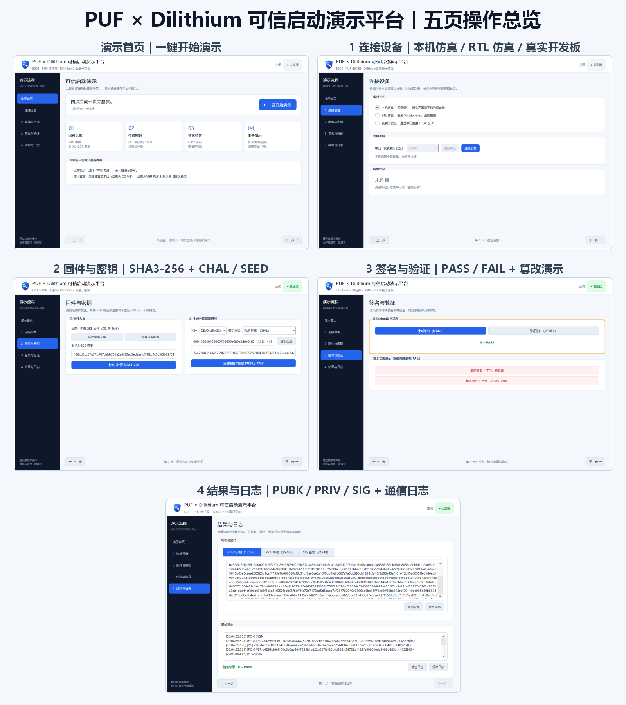

# 操作手册（USER_MANUAL）

**面向第一次接触本软件的使用者。** 按本手册可以选择运行方式、完成一键演示或逐页操作，并正确解释结果。

> **先读技术声明**：全链路仿真（RTL）中的 PUF 是 SHAKE-256 行为模型，不是物理 PUF。硬件开发板已接普安信 HD13HS10K 真 PUF 芯片（I2C），2026-10-21 全链路实测通过（`D:\FPGA\sim_logs\BOARD_PUF_NOTES.md`）。

## 目录

1. 软件功能与两种运行方式
2. 安装和启动
3. 六页界面与控件
4. 一键演示
5. 逐页操作、安全演示和导出
6. 全链路仿真（RTL）方式
7. 硬件开发板方式
8. 常见问题
9. 命令与日志速查

---

## 1. 软件功能与两种运行方式

软件演示以下链路：

1. PC 将恰好 2048 字节的固件交给后端，得到 SHA3-256 摘要。
2. 通过 CHAL 挑战-响应或 SEED 直注取得 256 bit 种子，生成 Dilithium2 公私钥对。
3. 私钥对当前固件摘要签名，公钥验签。
4. PC 展示 PUBK、PRIV、SIG 和通信日志；篡改固件或签名后应显示 FAIL。

| 运行方式 | 计算位置 | PUF / 种子说明 | 适用场景 |
|---|---|---|---|
| 全链路仿真（RTL） | Vivado xsim 中的真实 RTL | testbench 内 PUF 行为模型，固定 DEV0 | RTL 对拍、取数，速度慢（全流程约 41 分钟） |
| 硬件开发板 | FPGA 板端固件和硬件核 | 真 PUF 芯片（HD13HS10K，I2C）或 SEED 直注 | 真板链路演示与验收 |

## 2. 安装和启动

### 2.1 安装 Python 与依赖

需要 Python 3.8 或更新版本。在 Windows cmd 中执行：

```bat
cd /d D:\FPGA\puf_pqc_demo_gui
python --version
python -m pip install -r requirements.txt
```

依赖只有 PyQt5 和 pyserial；Dilithium2 源码已内嵌在 `vendor\`，无需另外安装算法包。

### 2.2 启动

```bat
cd /d D:\FPGA\puf_pqc_demo_gui
python main.py
```

主窗口默认约 1440×920，左侧六页导航，顶部显示运行模式、串口、密钥/固件状态、忙碌指示和连接状态；底部为可折叠通信日志；页脚有步骤进度条与「■ 终止当前操作」按钮。

真板演示不再需要先运行 `一键启动_真板演示.bat`——拉板操作已内建到「1 连接设备」页（见 §7）。

## 3. 六页界面与控件



### 3.1 演示首页

- **“▶ 一键开始演示”**：执行固件入库 → 密钥生成 → 读取 PUBK/PRIV → SIGN → VERIFY。未连接时会按当前运行方式自动连接。
- 四张流程卡说明“固件入库、生成密钥、签名验签、安全演示”；信任链流水线实时高亮当前步骤。

### 3.2 1 连接设备

| 控件 | 说明 |
|---|---|
| “全链路仿真（RTL）” | 默认方式；连接时自动拉起 Vivado xsim 并强制核验进程真实存在 |
| “硬件开发板” | 串口连接 FPGA 板卡；选中后显示「硬件拉板」操作区，密钥方式默认 SEED |
| “串口（仅硬件开发板）” | 选择 COM 口 |
| “刷新串口” | 插拔 USB 串口后重新枚举 |
| “一键拉板” | 等效原 bat：清理残留 openocd/gdb → 启动 openocd → 下载固件 + 串口自检 |
| “停止 openocd” | 停止 GUI 托管的 openocd 进程 |
| “连接设备” / “断开连接” | 建立或结束会话；连接时自动执行 HELP 同步 |
| “链路状态” | 显示未连接、正在建立连接、设备已就绪或连接失败；RTL 就绪后显示 xsim pid |

### 3.3 2 固件下载

- **内置标准固件**（2KB `00..FF` 循环）是唯一正确件，对应金样摘要 `498cd3cc…`。
- **“选择外部固件文件（错误固件演示）”**：加载恰好 2048B 的其他文件——摘要会变，验签将 FAIL，这就是系统识别错误固件的方式。
- **“恢复内置标准固件”**：回到正确件。
- **“上传并计算 SHA3-256”**：上传当前固件，摘要 64 位十六进制**完整显示**，并自动与 PC 侧 hashlib 计算的标准固件金样逐字节比对（✓ 一致 / ✗ 不一致）。

### 3.4 3 密钥生成

- **“芯片”**：DEV0 / DEV1（RTL 固定 DEV0；真板由物理芯片决定）。
- **“密钥方式”**：`PUF 挑战（CHAL）` 或 `直接种子（SEED）`。
- 激励输入框：64 个十六进制字符 = **256 bit**；下方实时显示“已输入 n/64 位 = 4n/256 bit，还差 x bit”。**“随机生成”**填入 32 字节随机值。
- **“生成密钥并读取 PUBK / PRIV”**：生成密钥对并在大文本框中**完整显示**公钥/私钥，可复制、可导出 .hex。

更换挑战/种子或芯片会清除旧密钥、签名和验签结果，需要重新生成后续数据。

### 3.5 4 签名与验证

- **“生成签名（SIGN）”**：对当前固件摘要签名；完整 SIG（4848 hex）在下方文本框显示，可复制/导出。
- **“验证签名（VERIFY）”**：验签大图卡 绿色 **0 = PASS** / 红色 **1 = FAIL**，并写明 FAIL 归属：
  - 【正常验签通过】
  - 【符合预期：防篡改演示 FAIL】
  - 【异常：未篡改却验签 FAIL】——需检查密钥/固件状态
- **安全攻击演示**两个红色按钮（篡改签名 / 篡改固件）预期结果都是 FAIL，属正常演示。

> 私钥展示和导出仅用于演示验收，请勿把演示私钥用于真实产品。

### 3.6 用户操作说明

操作指引、参数设置（波特率/超时/篡改位置随机/深色模式，写入 settings.json）、演示报告导出（Markdown）与技术背景。

### 3.7 设备实况与进度

- 每个步骤页底部的「设备实况」窗：RTL 模式实时滚动 xsim console 日志；真板模式回显串口收发帧；拉板过程输出也在其中。
- 页脚进度条：RTL 长操作按历史实测耗时估算进度（已用 / 预计）。
- 「■ 终止当前操作」：随时中止——立即杀 xsim 进程树并清理信箱残留，不产生僵尸进程或卡顿。

## 4. 一键演示

1. 启动软件，默认“全链路仿真（RTL）”（需 Vivado 2019.2）。
2. 在演示首页点击 **“▶ 一键开始演示”**。未连接时会自动连接（含拉起 xsim）。
3. 顶部显示“忙碌 · 一键演示全流程”，页脚显示估算进度；各页「设备实况」滚动显示 RTL 日志。
4. 完成后自动进入“4 签名与验证”，验签结果应为绿色 **0 = PASS**。

RTL 全流程约 41 分钟；硬件开发板快得多。RTL 模式 DEV0 + 默认 CHAL + 内置固件时关键值：

| 项目 | 预期值 |
|---|---|
| SHA3-256 | `498cd3cc87a77b907debb761a2e6f59ed9edeaefc74f2c9c5c5f3b62f64c4aa1` |
| 行为模型 R | `7a472b8311da5759b39f9618c8731a252a310d318f6dc71ca71c448f4cd31b75` |
| PUBK 前缀 | `ba5fa313ffba9519…` |
| SIG 前缀 | `d4299cf0ef104c3e…` |

这些值不适用于真板（真 PUF 响应由物理芯片决定）。

## 5. 逐页操作、安全演示和导出

### 5.1 手动执行正常链路

1. **1 连接设备**：选择运行方式（真板先「一键拉板」），点击“连接设备”，等“设备已就绪”。
2. **2 固件下载**：点击“上传并计算 SHA3-256”。
3. **3 密钥生成**：选择 CHAL 或 SEED，点击“生成密钥并读取 PUBK / PRIV”。
4. **4 签名与验证**：依次点击“生成签名（SIGN）”“验证签名（VERIFY）”。

### 5.2 篡改签名

前置：已经完成一次 SIGN。点击 **“篡改签名 1 字节，再验签”**，应出现红色 **1 = FAIL**（符合预期），并标注篡改位置。

### 5.3 篡改固件

前置：已经完成一次 SIGN。点击 **“篡改固件 1 字节，再签名并验证”**：篡改固件并重新入库 → 对新摘要签名 → 恢复原固件 → 用原摘要验新签名，应 FAIL；内置固件篡改后的摘要前缀为 `40e61a44…`。

### 5.4 错误固件演示

在「2 固件下载」点“选择外部固件文件”载入任意其他 2048B 文件（或先篡改 1 字节保存），入库后摘要与金样比对显示 ✗ 不一致，继续签名验签将 FAIL——这就是“给一份错误固件如何识别”的完整演示路径。

### 5.5 保存结果

PUBK / PRIV（密钥生成页）、SIG（签名与验证页）均可“复制全部”或“导出 .hex”；“保存日志”留档通信日志；「用户操作说明」页可导出演示报告（Markdown）。修改输入后旧结果会被清除，应先保存再开始下一轮。

## 6. 全链路仿真（RTL）方式

前提：Vivado 2019.2、对应 RTL 工程和 Git Bash 已配置。无需新增 Python 依赖。

1. 进入“1 连接设备”，选择 **“全链路仿真（RTL）”**。
2. 点击“连接设备”。首次可能自动编译；连接成功必经**进程核验**（系统里必须找得到 xsim 进程，否则连接直接失败）——界面上看到的结果必然来自真实 RTL。
3. 芯片下拉固定 DEV0，串口控件不可用。
4. 回首页一键演示，或按 §5.1 逐页操作。长命令期间看页底「设备实况」滚动与页脚进度条，不要误判为卡死。
5. 中途可用「■ 终止当前操作」；完成后点击“断开连接”或正常关窗，后端会收掉 xsim（关窗走快速收尸，不卡顿）。

专项路径、耗时和桥接排障见 [RTL_MODE_GUIDE.md](RTL_MODE_GUIDE.md)。

## 7. 硬件开发板方式

每次上电后在 GUI 内完成拉板：

1. 进入“1 连接设备”，选择 **“硬件开发板”**，选好 COM 口。
2. 点击 **“一键拉板”**：清理残留 openocd/gdb → 启动 openocd（GUI 托管）→ gdb 下载 `test_board_puf.elf` → 串口 HELP×2 + CHAL 真 PUF 自检。过程输出实时显示在页底「设备实况」。
3. 自检通过后点击“连接设备”。
4. 回首页一键演示或逐页操作。真板默认 SEED 直注；接好真 PUF 后可用 CHAL。
5. 更换 PUF 板子：直接把连线换到另一块板即可，窗口无需改动。

**FLASH 与固件的区别**：FPGA 设计的 FLASH 持久化已成功，上电后设计仍在；但处理器固件每次上电需重新拉板。排障见 **[BOARD_OPERATION_GUIDE.md](BOARD_OPERATION_GUIDE.md)**。

## 8. 常见问题

**Q1. 提示 `ModuleNotFoundError: PyQt5` 或 `serial`？**
用启动软件的同一个 Python 执行 `python -m pip install -r requirements.txt`。

**Q2. 点击功能按钮后跳到连接页？**
尚未建立会话。先连接，或直接在首页使用“一键开始演示”自动连接。

**Q3. 按钮变灰、顶部一直“忙碌”？**
上一项任务仍在后台执行。RTL 步骤可能十几分钟，看页底「设备实况」是否在动；确实想放弃就点「■ 终止当前操作」。

**Q4. 硬件开发板的串口下拉为空？**
检查 USB 线和驱动，在设备管理器确认 COM 口，再点击“刷新串口”。

**Q5. 打开 COM 口时提示 `Access is denied`？**
串口被其他程序占用。关闭串口助手、其他 GUI 和 `board_demo_run.py`，再重新连接。

**Q6. 真板出现 `timeout: cmds`？**
通常是本次上电后未拉板（固件未下载/未 resume），也可能是 COM 占用或 JTAG 问题。按 [BOARD_OPERATION_GUIDE.md](BOARD_OPERATION_GUIDE.md) 排查。

**Q7. 首帧出现 `UNKNOWN CMD`？**
第一次 HELP 吸收 UART 复位后的畸变字节属正常现象；第二次 HELP 返回 `cmds:` 即可继续。

**Q8. 挑战/种子输入提示须为 64 hex？**
输入必须恰好是 32 字节（256 bit）的十六进制文本。看输入框下方的 bit 计数器，或点“随机生成”。

**Q9. 选择固件时被要求恰好 2048B？**
当前 FW 协议定长 2KB。请换用 2048B 文件或点击“恢复内置标准固件”。

**Q10. 出现 `RES NOT READY`？**
固件摘要或密钥未就绪，或修改输入后旧结果已被清除。重新执行固件下载、密钥生成，再 SIGN/VERIFY。

**Q11. 篡改按钮提示先完成签名？**
先执行正常链路并得到 SIG，再运行两种篡改演示；它们的预期结果都是 FAIL。

**Q12. 4K 屏文字过小或布局异常？**
将 Windows 缩放暂时调至 100%，或为 Python 配置合适的高 DPI 兼容设置。窗口最小尺寸为 1240×800。

## 9. 命令与日志速查

帧为 ASCII 文本、`\r\n` 结尾。GUI 不修改协议，只按当前页面调用后端。

| 命令 | 作用 | 对应 GUI 操作 |
|---|---|---|
| `HELP` | 链路同步与查询命令集 | 连接时自动执行同步 |
| `FW <4096hex>` | 2KB 固件入库并返回 SHA3-256 | “上传并计算 SHA3-256” |
| `CHAL <64hex>` | 挑战—响应并以 R 生成密钥 | CHAL 模式下“生成密钥并读取 PUBK / PRIV” |
| `SEED <64hex>` | 直接以 256 bit 种子生成密钥 | SEED 模式下同一按钮 |
| `PUBK` / `PRIV` | 读取公钥 / 私钥 | 密钥生成后自动调用 |
| `SIGN` | 对当前摘要签名 | “生成签名（SIGN）” |
| `VER <4848hex>` | 验证 2424B 线上格式签名 | “验证签名（VERIFY）”和篡改演示 |
| `WIPE` / `DONE` | 清零私钥 / 通知测试台结束 | 协议与后端支持，当前页面无单独按钮 |

日志前缀：`[PC]` PC 命令，`[PC>]` 线上帧，`[FPGA]` FPGA/固件响应，`[PUF]`/`[PUF>]` PUF 通道，`[LINK]` 桥接/xsim 状态，`[BRINGUP]` 拉板过程，`[SYS]`/`[ERR]` GUI 状态或错误。

协议真源：`D:\FPGA\sim_logs\UART_PROTOCOL.md`；命令语义真源：`D:\FPGA\Dilithium-master\main_demo.c`。
